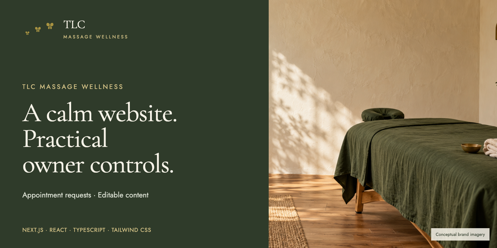
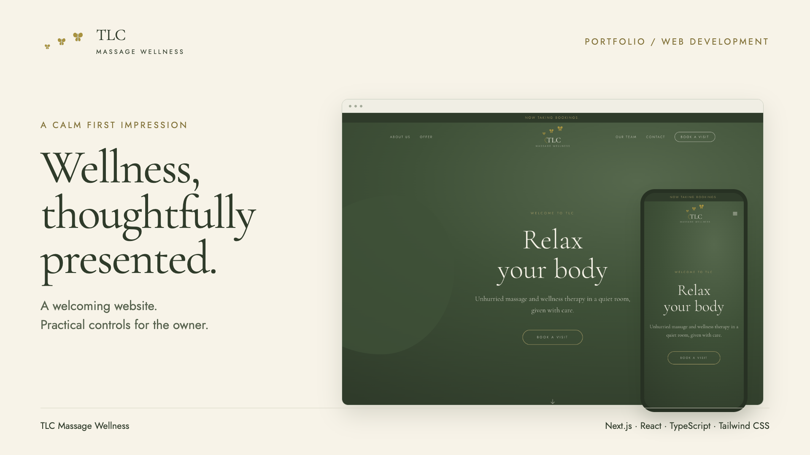
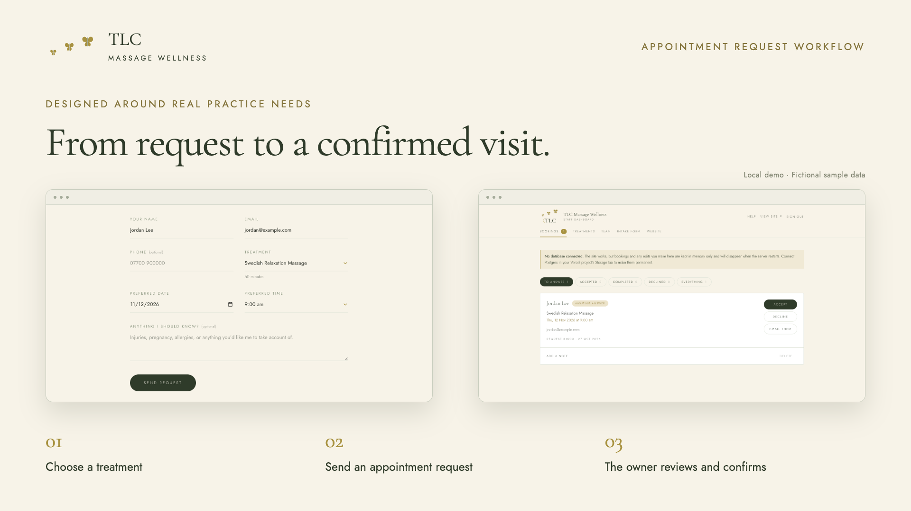
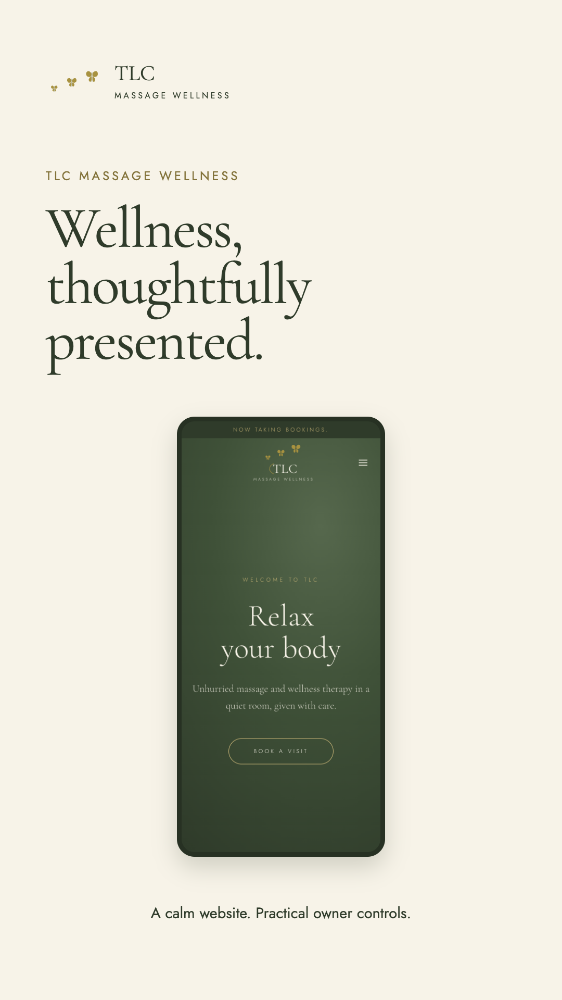
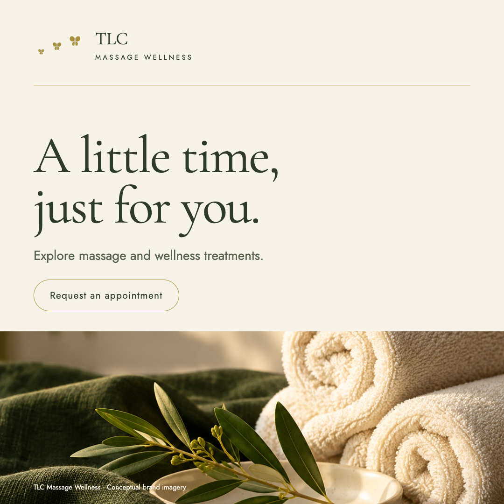
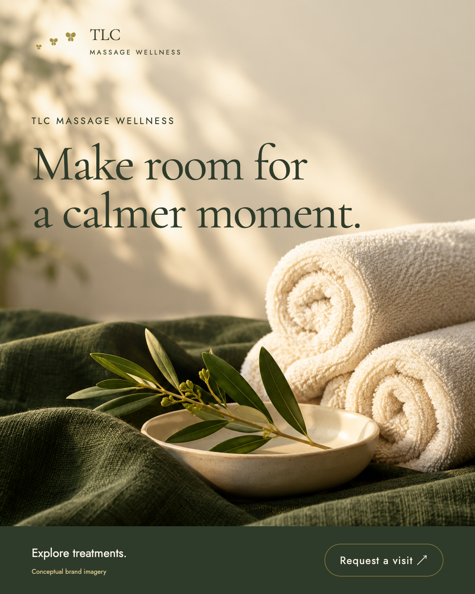

# TLC Massage Wellness

A booking website for **TLC Massage Wellness**, built so the owner can change
every word of it from a password-protected admin — no developer, no CMS
subscription, no code.

There is no payment step in the app yet — treatments have no price field. It
runs on Vercel's Hobby plan with a free-tier Postgres database, so hosting
costs nothing either.


## Project showcase



**Wellness, thoughtfully presented.** A mobile-first website with treatment discovery, appointment requests and an owner-editable admin.

[Video tours](#video-tours) · [Social and brand imagery](#social-and-brand-imagery) · [Marketing copy](#marketing-and-portfolio-copy) · [Complete media kit](./docs/media/tlc/README.md)

### Public experience and owner controls



Visitors explore treatments and request a preferred appointment. The owner reviews each request before confirming the visit and can edit the site's content, images, treatments and practitioner profiles.



### Video tours

Both videos are **20 seconds**, intentionally silent, and use readable titles with gentle motion. Select a thumbnail to open its MP4.

| Landscape portfolio tour | Vertical social tour |
| --- | --- |
| [](./docs/media/tlc/videos/tlc-portfolio-landscape.mp4) | [](./docs/media/tlc/videos/tlc-portfolio-vertical.mp4) |
| [Watch or download landscape MP4](./docs/media/tlc/videos/tlc-portfolio-landscape.mp4) · 1920 × 1080 | [Watch or download vertical MP4](./docs/media/tlc/videos/tlc-portfolio-vertical.mp4) · 1080 × 1920 |

### Social and brand imagery

The square and portrait graphics are ready for portfolio posts and brand promotion. Caption options are included below and in the [marketing copy](./docs/media/tlc/copy/marketing-copy.md).

| Square promotional image · 1080 × 1080 | Portrait promotional image · 1080 × 1350 |
| --- | --- |
| [](./docs/media/tlc/images/social-square.png) | [](./docs/media/tlc/images/social-portrait.png) |

Original conceptual brand photographs are included for future layouts:

| Treatment-room concept | Wellness still-life concept |
| --- | --- |
| [](./docs/media/tlc/images/wellness-room.png) | [](./docs/media/tlc/images/wellness-detail.png) |

*Interface captures show the local demo with fictional sample data. The two brand photographs were generated with AI and do not depict verified TLC premises. [Prompts and provenance](./docs/media/tlc/source/IMAGE-PROMPTS.md).*

### Marketing and portfolio copy

**Portfolio summary:** TLC Massage Wellness pairs a warm, mobile-first website with an admin for content, treatments, profiles and appointment requests.

**Brand message:** A little time, just for you. Explore massage and wellness treatments, then request a visit at a time that suits you.

**Project tags:** Next.js · React · TypeScript · Tailwind CSS · Postgres · Vercel Blob

The complete copy is available here and as standalone files: [Marketing copy and captions](./docs/media/tlc/copy/marketing-copy.md) · [Portfolio case study](./docs/media/tlc/copy/portfolio-case-study.md).

<details>
<summary><strong>Full marketing copy, social captions and video scripts</strong></summary>

Prepared for the project README, portfolio, social posts and video captions. Project reference: [taylordrew4u2/tlcmassagewellness](https://github.com/taylordrew4u2/tlcmassagewellness), reviewed at commit `ec8b6f349a42479765246369fae3d3919e71c287`.

#### Project headlines

**Primary:** A calm website. A practical way to manage appointment requests.

**Short cover line:** Wellness, thoughtfully presented.

**README line:** A massage and wellness website with editable content and an owner-managed appointment request workflow.

**Portfolio card:** TLC Massage Wellness pairs a warm, mobile-first website with an admin for content, treatments, profiles and appointment requests.

#### Short project summary

TLC Massage Wellness is a mobile-first website for a massage and wellness practice. Visitors can explore treatments and request an appointment, while the owner manages requests and updates the site through a password-protected admin.

#### Medium project summary

TLC Massage Wellness brings a calm public website and everyday practice management into one Next.js application. Visitors can browse treatments, view practitioner profiles and request a preferred appointment. The owner can review each request, accept or decline it, add private notes and mark accepted visits completed. A password-protected admin also controls site copy, images, treatments, optional intake questions and solo or team profiles. Forest green, antique gold and warm cream carry the butterfly identity through a layout built for phones.

#### Customer-facing creative copy

These lines describe the brand experience without claiming a medical outcome or an unverified business credential.

##### Hero option A

**A little time, just for you.**

Explore massage and wellness treatments, then request a visit at a time that suits you.

**CTA:** Request an appointment

##### Hero option B

**Make room for a calmer moment.**

Find a treatment, choose a preferred date and send your appointment request.

**CTA:** Explore treatments

##### Short promotional graphic

**Your next moment of calm starts here.**

TLC Massage Wellness

Explore treatments • Request a visit

##### Appointment explainer

Choose your treatment and preferred appointment details, then send a request. Your appointment is confirmed after the practice reviews and accepts it.

##### Calls to action

- Explore treatments
- Request an appointment
- Meet the practitioner
- Meet the team
- View the project
- Explore the code

#### Social captions

##### LinkedIn — portfolio project

TLC Massage Wellness combines a calm customer experience with the practical controls a small practice needs.

The public website presents treatments and practitioner profiles, then guides visitors into an appointment request. Behind it, a password-protected admin lets the owner accept or decline requests, add private notes, update content and images, manage treatments, and switch between solo and team profiles.

Built with Next.js, React, TypeScript and Tailwind CSS, with Postgres for persistent data and Vercel Blob support for photo uploads.

The design carries forest green, antique gold and warm cream across both the public site and the admin.

Explore the project: https://github.com/taylordrew4u2/tlcmassagewellness

#WebDevelopment #Nextjs #Portfolio #SmallBusinessWebsite

##### LinkedIn — short

A closer look at TLC Massage Wellness: a mobile-first website with treatment discovery, appointment requests and an admin that gives the owner control over the content. Built with Next.js, React, TypeScript and Tailwind CSS.

Project: https://github.com/taylordrew4u2/tlcmassagewellness

#WebDevelopment #Nextjs #Portfolio

##### Instagram — portfolio carousel

A calm first impression, with useful tools behind it.

TLC Massage Wellness brings together treatment browsing, appointment requests and editable site content in a forest-green, gold and cream design.

Swipe through the public website and the owner admin. Project source: github.com/taylordrew4u2/tlcmassagewellness

#WebDesign #WebDevelopment #Nextjs #PortfolioDesign #WellnessWebsite

##### Instagram — brand creative

Make room for a calmer moment. Explore the treatments at TLC Massage Wellness and send an appointment request when you are ready.

#TLCMassageWellness #MassageAndWellness #TimeForYou

##### Short post / image caption

TLC Massage Wellness — a warm, mobile-first website with treatment discovery, appointment requests and owner-editable content.

https://github.com/taylordrew4u2/tlcmassagewellness

##### Video caption — portfolio

From the first impression to the admin behind it: a quick tour of TLC Massage Wellness. A Next.js website with editable content, treatments, practitioner profiles and an owner-managed appointment request workflow.

Source: https://github.com/taylordrew4u2/tlcmassagewellness

#### Video copy

##### 24-second portfolio teaser

| Time | On-screen text | Optional voiceover |
| --- | --- | --- |
| 0–4 s | TLC Massage Wellness / Wellness, thoughtfully presented. | “A calm first impression for TLC Massage Wellness.” |
| 4–8 s | Explore treatments | “A mobile-first website introduces the practice and its treatments.” |
| 8–12 s | Request an appointment | “Visitors choose their preferences and send an appointment request.” |
| 12–16 s | Review. Accept. Complete. | “The owner reviews requests and manages each visit in the admin.” |
| 16–20 s | Content the owner can update | “Copy, images, treatments and profiles can all be edited in one place.” |
| 20–24 s | Explore the project / github.com/taylordrew4u2/tlcmassagewellness | “Explore the TLC Massage Wellness project on GitHub.” |

##### 15-second brand teaser

| Time | On-screen text |
| --- | --- |
| 0–5 s | A little time, just for you. |
| 5–10 s | Explore massage and wellness treatments. |
| 10–15 s | TLC Massage Wellness / Request an appointment |

Use a verified public booking link or the real site's existing booking button when publishing a customer-facing version.

##### Carousel text — five slides

1. **TLC Massage Wellness** — A calm website with practical owner controls.
2. **A welcoming first impression** — Forest green, antique gold, warm cream and considered typography.
3. **A clear next step** — Browse treatments and request a preferred appointment.
4. **Made to be managed** — Review requests and update content, treatments, photos and profiles.
5. **Explore the project** — Next.js · React · TypeScript · Tailwind CSS. github.com/taylordrew4u2/tlcmassagewellness

#### Alt text suggestions

Adapt each description to the actual asset. Include visible interface content when it matters; avoid describing any concept image as a live screenshot.

- **README cover:** “TLC Massage Wellness project cover in forest green, antique gold and warm cream, with desktop and phone website previews.”
- **Homepage screenshot:** “TLC Massage Wellness homepage showing the butterfly logo, a large welcome heading and the appointment call to action.”
- **Treatment screenshot:** “Treatment cards on the TLC Massage Wellness website, each linking to the appointment request form.”
- **Booking screenshot:** “Appointment request form with contact details, treatment selection, preferred date and time, and a notes field.”
- **Admin screenshot:** “TLC Massage Wellness admin showing appointment requests and controls to review their status.”
- **Social graphic:** “TLC Massage Wellness promotional graphic reading ‘A little time, just for you’ in forest green and cream with gold butterfly details.”
- **Portfolio concept artwork:** “Portfolio artwork for TLC Massage Wellness, using the project's green, gold and cream palette with website mockups.”
- **Decorative butterfly or texture:** Use empty alt text when the same information appears in adjacent text and the image is purely decorative.

#### Capability wording

| Use this | Implementation detail |
| --- | --- |
| “Appointment requests” | The owner reviews requests before confirming them. |
| “Owner-managed request workflow” | Accept, decline, complete, reopen, filter and add private notes. |
| “Optional intake questions” | Short answer, long answer and yes/no questions can be configured. |
| “Editable content” | Public headings, copy, contact fields, images and other settings are editable. |
| “Solo or team profiles” | The admin can switch between a single practitioner and multiple profiles. |
| “Photo upload support” | Uploads require configured Vercel Blob storage; image URLs are also supported. |
| “Postgres-backed storage” | Persistent data requires a configured database; local fallback is in memory. |
| “Prepared email replies” | Reply controls open the owner's normal mail app. The app does not send email automatically. |

Do not describe the current project as offering instant confirmed booking, live calendar synchronization, online payments, automatic email delivery or proven conversion gains. Avoid publishing default contact details, sample practitioner information or sample treatment claims as verified business facts.

#### Brand reference

- Name: **TLC Massage Wellness**
- Forest green: `#2f3b2a`
- Antique gold: `#a89240`
- Warm cream: `#f7f3e8`
- Headings: **Cormorant Garamond**
- Supporting type: **Jost**
- Tone: calm, direct, personal, unhurried
- Visual motif: three rising butterflies

#### Finished 20-second portfolio videos

The included landscape and vertical MP4s use the same five-card sequence below. These are the final rendered videos; the longer and shorter scripts above remain alternate concepts for future edits. Both finished videos are intentionally silent, with all information carried by the on-screen design.

| Time | Finished card / purpose |
| --- | --- |
| 0–4 s | Wellness, thoughtfully presented |
| 4–8 s | A clear next step |
| 8–12 s | Review. Accept. Complete. |
| 12–16 s | Keep the website yours |
| 16–20 s | Explore the project — “Care on the surface. Control behind it.” |

The videos use five four-second cards, simple cuts and a slow 100%–103% center zoom on each card. Landscape is 1920 × 1080; vertical is 1080 × 1920. Both are H.264 MP4 at 30 fps with no audio track.

</details>

<details>
<summary><strong>Full portfolio case study</strong></summary>

A calm, mobile-first website with practical controls for the owner of a massage and wellness practice.

[View the repository](https://github.com/taylordrew4u2/tlcmassagewellness)

#### Project overview

TLC Massage Wellness combines a public website with a password-protected admin. The public experience introduces the practice, presents treatments and practitioner profiles, and lets visitors request a preferred appointment. The admin gives the owner control over requests, website content, treatments, photos and optional intake questions.

The project supports both a solo practitioner and a team. The owner can switch between those modes without deleting the stored team profiles.

#### The design problem

A wellness website needs to make it easy to understand the offer and take the next step. It also needs to remain useful after launch, when a treatment changes, a photo needs replacing or an appointment request arrives.

This project addresses both needs in one application: a calm presentation for visitors and a direct editing workflow for the owner.

#### Visual direction

The identity draws on forest green (`#2f3b2a`), antique gold (`#a89240`) and warm cream (`#f7f3e8`). Cormorant Garamond gives headings an expressive serif voice, while Jost keeps supporting text and controls clear. The butterfly mark connects the public pages and admin.

The public layout is designed for phones first. A single scrolling page moves through the introduction, treatments, practitioner profiles, appointment request form and contact details. A separate booking page provides a shareable destination and can open with a treatment already selected.

#### Visitor experience

Visitors can explore the treatment list, read about the practitioner or team, and choose a preferred date and appointment time. The request form collects contact details, treatment preferences, notes and any custom intake questions the owner has enabled.

Submitting the form creates a request awaiting an answer. The appointment is confirmed through the owner's review process; submitting the form does not reserve a guaranteed calendar slot.

#### Owner experience

The admin organizes routine work into bookings, treatments, team, intake and website settings. The owner can:

- Accept or decline appointment requests, mark accepted visits completed, reopen requests, filter their status and add private notes.
- Open a prepared response in the normal mail app.
- Add, reorder, hide or remove treatments and practitioner profiles.
- Switch between solo and team presentation.
- Configure short answer, long answer and yes/no intake questions.
- Edit public copy, contact information, appointment times and image links.
- Upload photos when Vercel Blob storage is configured.
- Use the built-in guide to work through setup section by section.

#### Technical approach

The application uses Next.js 16.2.11, React 19.2.4, TypeScript and Tailwind CSS 4. It uses the Next.js App Router and Server Actions for the public and admin workflows.

Postgres supplies persistent storage when configured. An in-memory fallback allows local exploration without a database, with the tradeoff that changes are lost when the process restarts. Photo uploads use Vercel Blob; image URL fields remain available when upload storage is absent.

Website content is defined centrally and exposed in the admin editor. That structure connects the public interface to the owner's editing controls and provides a repeatable way to add editable fields.

#### What the project demonstrates

The implementation demonstrates a complete path from a public treatment page to an owner-reviewed appointment request, alongside content editing and profile management. Its portfolio value lies in connecting the visual system to everyday tasks: helping a visitor find a treatment and helping the owner maintain the website and respond to requests.

No traffic, conversion, revenue, usability study or customer outcome data was supplied for this case study. The description reports the implemented experience and code capabilities.

#### Current boundaries

The project does not include online payment checkout, automatic email delivery or a synchronized booking calendar. Email replies open in the owner's mail application. A production deployment needs configured storage and real business content in place of sample defaults.

#### Portfolio card copy

**Title:** TLC Massage Wellness

**Description:** A mobile-first wellness website with treatment discovery, appointment requests and a password-protected admin for content, profiles and practice updates.

**Tags:** Next.js · React · TypeScript · Tailwind CSS · Postgres · Vercel Blob

**CTA:** View project

#### Suggested image sequence

1. **Cover:** A large public website preview and a phone preview, framed by the project's green, gold and cream palette.
2. **Public experience:** Homepage and treatment detail views with short captions.
3. **Request flow:** The appointment request form, with the caption “Visitors send a preferred date, time and treatment for owner review.”
4. **Owner controls:** Admin views showing appointment review, content editing and practitioner management.
5. **Design detail:** Palette, typography and butterfly motif.

Use real interface captures for capability evidence. Label styled compositions as mockups where their presentation could be mistaken for the deployed interface. Keep default contact information and sample personal data out of portfolio screenshots.

#### Source basis

Reviewed repository state: [`ec8b6f349a42479765246369fae3d3919e71c287`](https://github.com/taylordrew4u2/tlcmassagewellness/tree/ec8b6f349a42479765246369fae3d3919e71c287).

- [README: workflow, setup and design](https://github.com/taylordrew4u2/tlcmassagewellness/blob/ec8b6f349a42479765246369fae3d3919e71c287/README.md)
- [Package versions](https://github.com/taylordrew4u2/tlcmassagewellness/blob/ec8b6f349a42479765246369fae3d3919e71c287/package.json)
- [Public page](https://github.com/taylordrew4u2/tlcmassagewellness/blob/ec8b6f349a42479765246369fae3d3919e71c287/app/page.tsx)
- [Editable content definitions](https://github.com/taylordrew4u2/tlcmassagewellness/blob/ec8b6f349a42479765246369fae3d3919e71c287/app/lib/content.ts)
- [Booking and admin actions](https://github.com/taylordrew4u2/tlcmassagewellness/blob/ec8b6f349a42479765246369fae3d3919e71c287/app/actions.ts)

This case study describes the project in third person. Add personal role, responsibilities, collaborators and project dates only after those details are verified.

</details>

### Downloads and editable sources

- [All promo images](./docs/media/tlc/images/) and [both video formats](./docs/media/tlc/videos/).
- [Original interface captures](./docs/media/tlc/screenshots/).
- [Artwork source and rebuilding instructions](./docs/media/tlc/source/ARTWORK-REBUILD.md).
- [Video source and rebuilding instructions](./docs/media/tlc/source/VIDEO-REBUILD.md), [timing manifest](./docs/media/tlc/source/video-timing.json) and [source cards](./docs/media/tlc/source/video-slides/).
- [Usage and alt-text guide](./docs/media/tlc/USAGE.md), [font licenses](./docs/media/tlc/source/fonts/) and [asset manifest](./docs/media/tlc/asset-manifest.json).

---

## What it does

### The public site (`/`)

A single scrolling page in the brand's green and gold:

- **Hero** — heading, sub-heading, button label and background photo, all editable
- **About us** — paragraphs, a list of highlights, and a photo
- **Our offer** — the treatment list, each with a "Book this" link
- **Our team** — either one profile for a solo practitioner (however they'd
  like to be addressed, plus a photo and bio) or a full list of therapists;
  switchable from the admin at any time
- **Intake questions** — optional custom questions on the booking form, shown
  only when turned on
- **Book a visit** — the request form
- **Contact** — address, opening hours, phone, email, directions link
- **Footer** — social links and a staff login link

`/book` is the same form on its own page, so "Book this" can land there with the
treatment already chosen.

### The admin (`/admin`)

Sign in with the password (default `Elliott1999` — see [Environment variables](#4-environment-variables)).

| Tab | What you can do |
|---|---|
| **Bookings** | See every request. **Accept** or **decline** it in one tap, mark it done, reopen it, leave a private note, or open a pre-written reply in your own mail app. Filter by status; the tab shows a badge for anything still waiting. |
| **Treatments** | Add, edit, reorder, hide, or delete treatments. They appear on the website and in the booking form immediately. |
| **Team** | A switch at the top picks **Just me** or **Team**. Solo mode is a single profile — name (however you'd like to be addressed), title, photo, bio. Team mode is the full add/edit/reorder/hide/delete list for multiple therapists. Switching modes doesn't delete anything; extra profiles just wait, hidden, until you switch back. |
| **Intake form** | Add, edit, reorder, or remove the custom questions shown on the booking form — short answer, long answer, or yes/no, each optionally required. The switch that turns the whole thing on, and its intro text, live on the Website tab. |
| **Website** | Every heading, paragraph, label, address, opening hour and image link on the public site, grouped into sections. Also holds the switch that closes bookings, the list of appointment times people can choose from, and the intake-form switch and intro text. |

A guided setup walks through the site section by section — one click away
from the **Help** link at the top of the page, and from a floating button in
the corner of the screen. Each step explains what that part of the site is,
with the real fields (or the real Treatments/Team editor) right there to
fill in and save on the spot, or skip and come back to later from its own
tab. The floating button can be turned off from inside the guide — the
**Help** link in the header always stays, so it's never out of reach.

### How a booking flows

1. A visitor fills in the form: name, email, phone, treatment, date, time,
   any intake questions you've turned on, and notes.
2. It arrives in the admin as **awaiting answer**, and the Bookings tab shows a count.
3. You **accept** or **decline**. Accepted requests can later be marked **completed**.
4. "Email them" opens your normal mail app with the confirmation already written.

No email is sent by the app itself, which is why it needs no mail service, API
key, or sending domain.

---

## 1. Deploy to Vercel

### Step 1 — Push to GitHub

Push this repository to GitHub (public or private).

### Step 2 — Create the Vercel project

1. [vercel.com](https://vercel.com) → **Add New Project**
2. Import the repository
3. Framework: **Next.js** (detected automatically)
4. **Deploy**

The site will already work at this point — it renders its built-in copy — but
nothing you change in the admin will be saved until you do step 3.

### Step 3 — Add a free Postgres database

1. Vercel project → **Storage** → **Create Database** → **Postgres** (Neon, free tier)
2. Connect it to the project, for all environments (Production, Preview, Development)

Vercel injects the connection variables for you — either `POSTGRES_URL` or
`DATABASE_URL` depending on which flow provisioned it, and the app reads
whichever is present. The tables are created on the first request, and the
treatment list is seeded once — if you delete every treatment it stays deleted.

### Step 4 — Add Blob storage for photo uploads

1. Same project → **Storage** → **Create Database** → **Blob** (free tier)
2. Connect it to the project, for all environments

This adds `BLOB_READ_WRITE_TOKEN`, which is what lets the admin upload photos
(hero background, about photo, team photos) instead of pasting a link. Without
it, those fields still accept a pasted link — they just can't accept an
uploaded file.

### Step 5 — Environment variables

Project → **Settings** → **Environment Variables**:

| Variable | Required | Description |
|---|---|---|
| `ADMIN_PASSWORD` | Recommended | The `/admin` password. **Defaults to `Elliott1999`** if unset — set your own before the site goes live. |
| `POSTGRES_URL` / `DATABASE_URL` | Yes, for saving | Added automatically by the Postgres step above. |
| `BLOB_READ_WRITE_TOKEN` | Yes, for photo uploads | Added automatically by the Blob step above. |

### Step 6 — Redeploy

**Deployments** → latest → **Redeploy** — this is required after connecting
storage, since the running deployment was built before the variables existed.
Then open `/admin`, sign in, and make the site yours.

---

## 2. Local development

```bash
npm install
npm run dev
```

- Website: http://localhost:3000
- Admin: http://localhost:3000/admin (password `Elliott1999`)

Without a database the app keeps everything in memory, so it runs and looks
right but forgets on restart — the admin shows a banner saying so. To develop
against real storage, copy the connection details from Vercel → Storage → your
database → `.env.local`. Do the same for Blob storage (`BLOB_READ_WRITE_TOKEN`)
to test photo uploads locally.

---

## 3. Project structure

```
app/
├── layout.tsx                Fonts, metadata, root HTML
├── page.tsx                  The public site
├── globals.css               Palette and shared styles
├── icon.svg                  Favicon
├── apple-icon.png            Home-screen icon for "Add to Home Screen" on iOS
├── actions.ts                Server Actions — booking, login, every admin write
├── book/page.tsx             The booking form on its own page
├── lib/
│   ├── content.ts            Every editable line of copy, and its default
│   ├── db.ts                 Postgres, with an in-memory fallback
│   └── normalize.ts          Turns pasted links and handles into safe hrefs
├── _components/
│   ├── Logo.tsx              The butterfly mark, drawn as SVG
│   ├── SiteNav.tsx           Header and mobile menu
│   ├── SiteShell.tsx         Header + footer wrapper
│   ├── BookingSection.tsx    Booking headings and closed notice
│   ├── BookingForm.tsx       The request form
│   └── Reveal.tsx            Fade-up on scroll
└── admin/
    ├── page.tsx              Auth check
    ├── LoginForm.tsx         Password form
    ├── AdminDashboard.tsx    Tabs
    ├── BookingsPanel.tsx     Accept / decline / notes
    ├── ServicesPanel.tsx     Treatment editor
    ├── TeamPanel.tsx         Solo profile / team editor, switchable
    ├── IntakePanel.tsx       Intake question editor
    ├── ContentPanel.tsx      Website copy editor
    ├── ContentField.tsx      One content field, shared by ContentPanel and HelpGuide
    ├── ImageUploadField.tsx  Photo upload widget, shared by the panels above
    ├── HelpGuide.tsx         The guided setup, Help link and floating button
    └── ui.ts                 Shared class strings
```

### Adding a new editable line to the site

Add a field to the right group in `app/lib/content.ts`. It appears in the admin
editor, gets a default, and is available as `content.your_key` in the page — no
other file needs to know about it.

---

## 4. Design

The palette comes from the logo and nothing else: the deep forest green of the
lettering (`#2f3b2a`), the antique gold of the butterflies (`#a89240`), and the
warm cream behind them (`#f7f3e8`). Headings are set in Cormorant Garamond and
everything else in Jost, both self-hosted at build time by `next/font`.

The layout is built mobile-first — most visitors will be on a phone. The hero
photo loads first and the rest of the page's images load as they scroll into
view, so the site stays quick on a mobile connection. A visitor can also add
the site to their phone's home screen, where it shows the butterfly mark as
its icon.

---

## 5. Dependencies

- `next`, `react`, `react-dom` — App Router
- `@vercel/postgres` — database client
- `@vercel/blob` — photo upload storage
- `tailwindcss`, `typescript`, `eslint`
